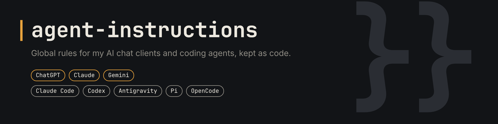

<p align="center">
  
</p>

<p align="center">
  <a href="https://github.com/nervouna/agent-instructions/actions/workflows/lint.yml"></a>
  <a href="LICENSE"></a>
  
</p>

These are the global instructions I give to my AI chat clients and coding agents: how to talk to me, how to write code for me, and when to stop and ask. They are personal preferences, kept in one place so every client gets the same rules and every change goes through review.

You probably arrived here by accident. You are welcome to read, copy, and adapt anything.

## What is here

| Client | File | Goes to |
| :--- | :--- | :--- |
| ChatGPT | [`chatgpt/astra-6-2.md`](chatgpt/astra-6-2.md) | Custom instructions |
| Claude | [`claude-chat/fable-5-2.md`](claude-chat/fable-5-2.md) | User preferences |
| Gemini app | [`gemini/gemini-4.md`](gemini/gemini-4.md) | Instructions for Gemini |
| Claude Code | [`claude-code/fable-5-2.md`](claude-code/fable-5-2.md) | `~/.claude/CLAUDE.md` |
| Codex | [`codex/gpt-6-2.md`](codex/gpt-6-2.md) | `~/.codex/AGENTS.md` |
| Antigravity | [`antigravity/gemini-4.md`](antigravity/gemini-4.md) | `~/.gemini/GEMINI.md` |
| Pi | [`pi/all-models.md`](pi/all-models.md) | `~/.pi/agent/AGENTS.md` |
| OpenCode | [`opencode/all-models.md`](opencode/all-models.md) | `~/.config/opencode/AGENTS.md` |

## How it works

- Each file above is generated. Its source lives under [`src/`](src), and paragraphs used by several clients live once under [`shared/`](shared).
- [`notes/`](notes) records why each rule exists: what was read or observed, and what a client refused to accept.
- A linter checks formatting, stale output, and missing notes on every pull request.

```sh
python3 scripts/build.py
python3 scripts/lint.py
```

The full conventions are in [`AGENTS.md`](AGENTS.md), which is written for the agents that maintain this repository.

## License

[MIT](LICENSE)
